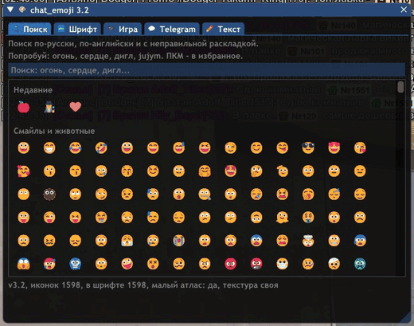
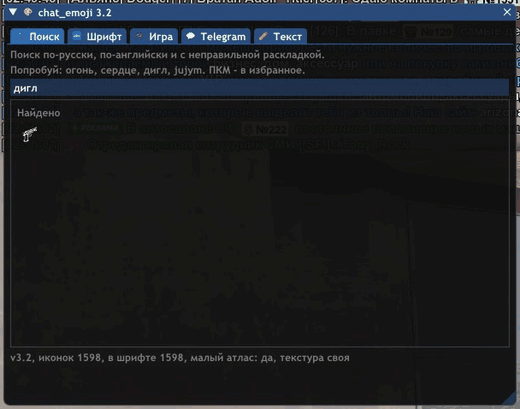
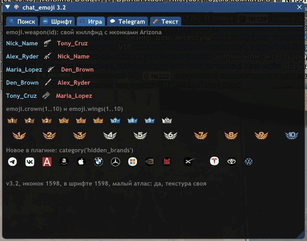
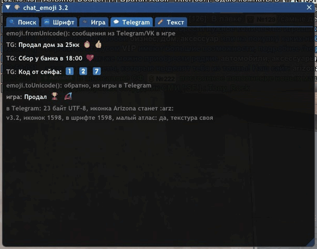
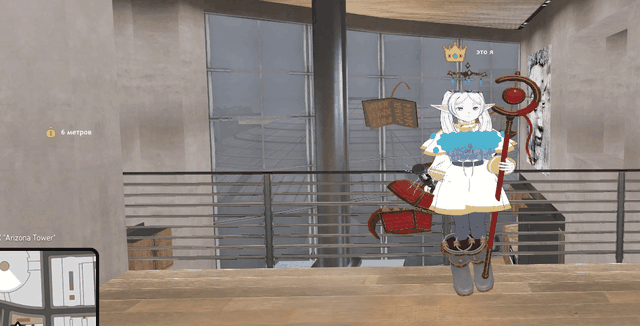

# chat_emoji: смайлы из `_chat.asi` в mimgui, диалогах SA-MP и шрифте ImGui

Разбор плагина чата Arizona Games (`_chat.asi`), извлечение всех **1598 смайлов и иконок**
в том же порядке, что и в панели чата, и готовая библиотека для MoonLoader, которая умеет:

* **рисовать их в mimgui** - своей текстурой, на любом сервере: картинкой, в тексте
  с переносами и цветами сервера, в кнопках, списках, подсказках, поверх игры
  и метками над точками в мире;
* **вшивать их в шрифт ImGui** - и тогда смайлы работают в обычных `imgui.Text`,
  `Button`, `Combo`, вкладках и даже в `InputText` прямо при наборе;
* **вставлять их в чат и обычные диалоги SA-MP** - там рисует уже сам плагин чата,
  от скрипта нужна только строка с токеном;
* **искать по-русски** («огонь», «сердце», «дигл») и с неправильной раскладкой;
* **переводить в настоящие смайлы Unicode и обратно** - для мостов с Telegram, VK, Discord.

| | |
|---|---|
|  |  |
|  |  |



---

## Что нового в 3.2

* **14 новых иконок** из сентябрьского обновления плагина: Telegram, VK и логотипы
  компаний с биржи (`telegram`, `vk`, `tesla`, `nvidia`, `sp500`...). Имя `apple`
  плагин отдал логотипу Apple, а 🍎 теперь ищется как `red_apple` - у всех
  стандартных смайлов появились стабильные имена из базы Unicode.
* **Атлас без пустой половины**: 2048×1360 вместо 2048×2048, около 11 МБ видеопамяти
  вместо 16. Плюс **малый атлас** (ячейка 20 px) для смайлов до 20 px: ImGui рисует
  без mip-уровней, и сжатая втрое картинка рябила. `emoji.FORMAT = 'dxt5'` сжимает
  обе текстуры ещё вчетверо.
* **`emoji.fontGlyphs()`** - смайлы прямо в шрифте ImGui (см. [ниже](#смайлы-прямо-в-шрифте-imgui)).
* **Поиск по-русски** по словам из Unicode CLDR, по названиям категорий и с неправильной
  раскладкой: `jujym` найдёт «огонь», `ашку` найдёт `fire`. Лучшие совпадения - первыми.
* **`toUnicode` / `fromUnicode`** - мост с Telegram, VK и Discord.
* **`weapon(id)`, `crown(n)`, `wings(n)`** - иконки оружия по номеру GTA, короны и крылья с цифрой.
* **`sendChat` делает паузу между частями** длинного сообщения. Раньше вторая часть
  улетала в том же кадре и съедалась антифлудом.
* **`fit()` различает «вижу я» и «видят все».** Лаунчер Arizona грузит плагин чата
  и на чужих серверах, и там токен, отправленный в чат, у остальных превращался в
  `:u1f603:`. Теперь `sendChat` проверяет название сервера (`emoji.serverSupports()`).
* **`reload()` после пересборки берёт новую текстуру**, а не старую общую из соседнего
  скрипта: в ключ общей текстуры вошёл хеш атласа. И последний держатель старой
  текстуры больше не стирает из общего слота новую.
* **Библиотека замечает обновление `_chat.asi`**: сверяет размер и время сборки плагина
  с теми, по которым собран атлас, и пишет в `moonloader.log`, что пора запустить
  `rebuild.bat`.
* **`drawText`, `drawImage`, `draw3D` и `tooltipText` снова рисуют смайлы** - в 3.1
  они молча ничего не делали (функции mimgui - C-функции, а проверялись как Lua).
* **Кеш раскладки текста**: `text()`, `drawText()` и виджеты больше не меряют каждое
  слово каждый кадр.
* **Аннотации LuaLS**: автодополнение и подсказки типов в VS Code.
* `category('hidden_weapons')` - короткие ASCII-имена категорий,
  `emoji.atLeast('3.2')` - проверка версии, `setPickerQuery()` - строка поиска панели снаружи.

Всё API 3.1 работает как раньше. Полная история - в [CHANGELOG.md](CHANGELOG.md).

---

## 1. Что внутри `_chat.asi`

`_chat.asi` - это PE32 DLL (ImGui + FreeType + lunasvg, PDB-путь
`C:\source\imgui-chat\...\_chat.pdb`). Смайлы там лежат в трёх местах.

### Списки панели

Панель строится из **семи массивов `uint32`** в `.rdata` - по одному на вкладку.
Каждый адресуется прямо из кода, и порядок обращений в `.text` задаёт порядок
вкладок:

| адрес (сборка 08.09.2026) | штук | содержимое |
|-------|------|------------|
| `0x100CDF18` | 269 | смайлы и животные |
| `0x100CDD10` | 130 | люди и жесты |
| `0x100CD540` | 346 | праздники и предметы |
| `0x100CDAA8` | 153 | еда и растения |
| `0x100CD208` | 205 | транспорт и места |
| `0x100CE350` | 210 | символы |
| `0x100CE6A0` | 41 | буквы-плашки, цифры и логотипы серверов |

Последняя вкладка добирается прямо в коде: в `.rdata` лежат только первые 16
букв (их копирует один развёрнутый SSE-блок), буквы `Q`–`Z` плагин генерирует
циклом от `U+1F1E6`, а цифры `0`–`9` (`U+1FC10…U+1FC19`) и пять логотипов
серверов записаны отдельными инструкциями. Извлекатель дочитывает этот хвост,
сканируя immediate в `.text` после последнего обращения к массиву.

Итого **1354** смайла в порядке, совпадающем со стандартным Unicode/CLDR.
Группировка у Arizona своя: животные лежат вместе со смайлами, растения - с
едой, часы - с сердцами.

### Таблица имён

Отдельно, в `.data`, лежит массив из 838 структур:

```c
struct { const char* name; uint32_t codepoint; };
```

Например `{"smiley", 0x1F603}`, `{"arz", 0x1FC08}`, `{":)", 0x1F642}`.

Это **словарь текстовых шорткатов, а не список панели**: у части смайлов панели
имени нет вовсе, а серверные иконки Arizona (`arz`, `redcode`, `buy`, `ВИП ЧАТ`
и подобные) в панель не попали, хотя в чат их вставить можно.

Имена в таблице не вечные: в сентябрьской сборке имя `apple` ушло от 🍎 к
логотипу Apple. Поэтому сборщик атласа добавляет каждому стандартному смайлу
ещё и имя из базы Unicode (`red_apple`, `face_with_tears_of_joy`), которое от
плагина не зависит.

### Скрытые иконки

Сверх этого в `icons.ttf` лежат глифы, которые не объявлены нигде: ни в панели,
ни в таблице шорткатов. В чате они рисуются - это ленты и плашки ников, короны
VIP, крылья-уровни, значки лавок и недвижимости, телефоны, деньги и целый набор
оружия. Извлекатель вычитывает их прямо из cmap шрифта и кладёт в конец
отдельными группами:

| группа | id | штук |
|--------|----|------|
| Скрытые: интерфейс | `hidden_ui` | 12 |
| Скрытые: ленты и плашки | `hidden_ribbons` | 53 |
| Скрытые: VIP и уровни | `hidden_vip` | 27 |
| Скрытые: значки сервера | `hidden_badges` | 14 |
| Скрытые: цифры и метки | `hidden_marks` | 17 |
| Скрытые: оружие | `hidden_weapons` | 65 |
| Скрытые: недвижимость и чат | `hidden_property` | 32 |
| Скрытые: биржа и соцсети | `hidden_brands` | 14 |
| Скрытые: интерфейс (big_icons) | `hidden_big_ui` | 10 |

Иконки оружия идут подряд по номерам GTA (`U+F300` - кулак), только номера 19–21
в игре пустые и в шрифте пропущены, камеры (43) нет, а у обоих видов очков одна
картинка. Короны с цифрами 1–10 - это `U+F245…U+F24E`, крылья - `U+F250…U+F259`.
На этом построены `emoji.weapon()`, `emoji.crown()` и `emoji.wings()`.

Плюс `big_icons.ttf` - второй шрифт плагина, крупные иконки интерфейса
(пузырь чата, череп, плашка «ТЯЖЕЛО РАНЕН»). Десять его кодовых точек не
пересекаются с `icons.ttf`, они вынесены отдельной группой. В чат эти,
скорее всего, не вставляются - текст чата рисуется другим шрифтом.

Итого в атласе **1598** записей: 1354 из панели чата плюс 244 скрытых.
Это **все** глифы обоих шрифтов иконок, ничего не осталось.

### Шрифты

Четыре шрифта лежат в ресурсах `RCDATA` в **сжатом виде**. Формат сжатия -
`stb_compress` (сигнатура `0x57bC0000`), тот самый, что выдаёт утилита ImGui
`binary_to_compressed_c`:

| ресурс | шрифт | что содержит |
|--------|-------|--------------|
| 101 | Arial Bold | текст чата |
| 102 | Heading Now Medium | заголовки |
| 103 | **icons** (COLR + CPAL + SVG) | серверные иконки: `U+F003…U+F341`, `U+1FC00…U+1FC46`, буквы-плашки `U+1F1E6…U+1F1FF` |
| 104 | **big_icons** (COLR + CPAL) | крупные иконки интерфейса |

### Стандартные смайлы

Их в плагине **нет**. `U+1F600` и соседей чат берёт из
**Segoe UI Emoji**: если рядом с игрой лежит `fontcustom\seguiemj_1.45.ttf`
(его кладёт лаунчер Arizona) - из него, иначе читает реестр
`SOFTWARE\Microsoft\Windows NT\CurrentVersion\Fonts` → `Segoe UI Emoji (TrueType)`
→ `%WINDIR%\Fonts\seguiemj.ttf`.

### Как смайл попадает в текст

Токеном `:u<hex>:` - формат `":u%x:"` в бинарнике. То есть 😃 в строке чата
выглядит как `:u1f603:`. Рядом живут `:item%d:` и `:slot%d_%d:` для предметов.

### Почему то же самое работает в диалогах SA-MP

Разборщик токенов у плагина один на всё. В `.text` есть функция, которая
берёт строку, ищет в ней `memchr`-ом двоеточия и разбирает то, что между
ними, - и она вызывается **из двух разных мест**: из отрисовки чата и из
перехваченных методов диалоговых контролов SA-MP.

Плагин ставит хуки двумя кластерами:

| диапазон в `samp.dll` | что это | как поставлено |
|---|---|---|
| `+0x666A0` … `+0x69260` | чат | `jmp rel32` и заглушки `ret` |
| `+0x011C0` … `+0x15A50`, `+0x40150` | GUI-классы, из которых собран диалог | `jmp rel32` и детуры с сохранением оригинала |

Во втором кластере видно всё нужное: перехват метода, принимающего `char*`
(плагин тут же считает длину строки), перехват добавления элемента списка и
перехват по идентификатору контрола. Каждый из трёх складывает результат
в общий кеш разметки - массив на 1004 слота по `0x1B0` байт, по слоту на
контрол, - и сбрасывает слот, когда контролу меняют текст.

Отсюда всё практическое:

* **текстура и mimgui для диалогов не нужны вообще.** Рисует плагин,
  от скрипта нужна только строка с токеном;
* **токен - чистый ASCII**, поэтому `sampShowDialog` с его cp1251 его
  не портит: перекодировать надо только свой русский текст;
* **там, где плагина нет**, токен останется видимым мусором `:u1f603:`,
  поэтому в модуле есть `emoji.fit()`.

---

## 2. Почему смайлы нельзя просто подключить шрифтом

Напрашивается `AddFontFromFileTTF('seguiemj.ttf', ...)`, но так не выйдет -
по двум независимым причинам:

1. **mimgui собран со `stb_truetype`.** Он растеризует только контуры `glyf` и
   ничего не знает про `COLR`/`CPAL` и `SVG `. У цветных шрифтов базовый контур
   глифа обычно пустой - весь рисунок лежит в цветных слоях. На выходе получатся
   пустые прямоугольники.
2. **`ImWchar` в mimgui 16-битный.** Смайлы живут в `U+1F300…U+1FAFF`, то есть
   выше `U+FFFF`. Такие кодовые точки в 16-битный тип физически не влезают, и
   `GlyphRanges` их не примет.

Поэтому смайлы **заранее растеризованы в текстуру** и рисуются через
`imgui.Image` / draw list. А для обычных виджетов ImGui в 3.2 есть обходной путь:
`emoji.fontGlyphs()` кладёт картинки из этой текстуры в атлас шрифта как
«свои глифы» на кодовых точках `U+E700…` - они в 16 бит помещаются, а
stb_truetype для них не нужен вовсе.

---

## 3. Что здесь лежит

```
chat_emoji/
├── rebuild.bat                  сборка в один клик (обёртка над rebuild.py)
├── CHANGELOG.md
├── tools/
│   ├── rebuild.py               весь цикл: распаковка _chat.asi + сборка атласа
│   ├── extract_chat_emoji.py    распаковка ресурсов и таблицы из _chat.asi
│   ├── build_emoji_atlas.py     растеризация смайлов в PNG-атласы
│   ├── cldr_ru.py               русские слова для поиска из Unicode CLDR
│   ├── test_chat_emoji.lua      самопроверка модуля (luajit, без игры)
│   └── ingame_check.lua         проверка в живой игре, для разработки
├── data/
│   ├── icons.ttf                распакован из ресурса 103
│   ├── big_icons.ttf            распакован из ресурса 104
│   ├── emoji.json               1598 смайлов: код, имена, категория
│   ├── emoji_list.lua           то же самое таблицей Lua
│   ├── source.json              размер и время сборки _chat.asi
│   └── cldr_ru.json             русские ключевые слова (Unicode CLDR)
└── moonloader/                  готово к копированию в папку moonloader
    ├── chat_emoji_minimal.lua   короткий пример: /sm
    ├── chat_emoji_demo.lua      витрина размеров и отправка в чат: /emj
    ├── chat_emoji_dialogs.lua   конструктор диалогов SA-MP: /emjd
    ├── chat_emoji_showcase.lua  всё новое в 3.2: /emjnew, автотур /emjtour
    ├── lib/chat_emoji.lua       модуль
    └── resource/chat_emoji/
        ├── chat_emoji.png       атлас 2048×1360, ячейка 40 px
        ├── chat_emoji_small.png тот же атлас вдвое меньше, для мелких смайлов
        ├── chat_emoji_atlas.lua описание с координатами
        └── chat_emoji_search.lua русские слова для поиска
```

---

## 4. Установка

Скопируйте содержимое `moonloader/` в папку `moonloader` в каталоге игры:

```
moonloader/lib/chat_emoji.lua
moonloader/resource/chat_emoji/            (вся папка)
moonloader/chat_emoji_showcase.lua         (или любой другой пример)
```

Папок `lib` и `resource/chat_emoji` может не быть - создайте. Малый атлас и
файл русского поиска необязательны: без них библиотека работает, просто мелкие
смайлы рисуются из большого атласа, а поиск понимает только латиницу и названия
категорий.

Примеры, кладите **что-то одно**:

| файл | команда | что показывает |
|------|---------|----------------|
| `chat_emoji_minimal.lua`  | `/sm`    | пять способов применения в полсотни строк |
| `chat_emoji_demo.lua`     | `/emj`   | панель выбора, витрина размеров, отправка в чат |
| `chat_emoji_dialogs.lua`  | `/emjd`  | конструктор диалогов SA-MP со смайлами |
| `chat_emoji_showcase.lua` | `/emjnew` | всё новое в 3.2: поиск, шрифт, иконки игры, Telegram, HUD; `/emjtour` - автотур для записи видео (в одиночной игре - F7 и F9) |

> **Про внешний вид.** Серверные иконки (логотипы, ВИП ЧАТ, короны, оружие,
> лавки) берутся из `icons.ttf` самого плагина, поэтому они **один в один**.
> Обычные смайлы в готовом атласе нарисованы Segoe UI Emoji из
> `fontcustom\seguiemj_1.45.ttf` - тем же файлом, что использует чат. Если ваш
> лаунчер положит другую версию, запустите **`rebuild.bat`**: он сам найдёт Python,
> поставит Pillow, отыщет ваш `_chat.asi` и шрифт рядом с ним и пересоберёт атлас.

---

## 5. Использование

```lua
local imgui = require 'mimgui'
local emoji = require 'chat_emoji'

imgui.OnInitialize(function()
    local ok, err = emoji.load()      -- грузит атлас и создаёт текстуры
    if not ok then print(err) end
end)
```

`emoji.unload()` вызывать не обязательно: с 3.1 библиотека сама отпускает текстуру,
когда скрипт выгружается. Если скрипту нужна определённая версия:

```lua
assert(emoji.atLeast('3.2'), 'нужен chat_emoji 3.2 или новее')
```

### Нарисовать смайл

```lua
emoji.image('smiley', 24)     -- по имени
emoji.image(0x1F603, 24)      -- по кодовой точке
emoji.image(':u1f603:', 24)   -- по токену
emoji.image('red_apple', 24)  -- по имени из базы Unicode
```

### Кнопка со смайлом

```lua
if emoji.button('arz', 32) then
    print('нажали на логотип Arizona')
end
```

### Текст со смайлами

```lua
emoji.text('привет :u1f603: как дела :u1f44b:')
emoji.text(строкаЧата, 18, { color = true, wrap = 400 })   -- цвета {RRGGBB} и перенос
emoji.richText('{FDCF28}Часы :u231a:{FFFFFF}\nвторая строка', 18)
local w, h = emoji.calcTextSize('строка :u1f525:', 18)       -- размер без отрисовки
```

Строка раскладывается один раз и рисуется одним проходом по draw list;
готовая раскладка кешируется, так что оверлей на полсотни строк не меряет
каждое слово каждый кадр. Переводы строк, перенос по ширине и цветовые теги
сервера работают, сами теги не видны.

### Размер и малый атлас

Аргумент - **высота в пикселях**, ширина считается сама (`size * cells`).
Задаётся при каждой отрисовке и ничем не зафиксирован.

Ячейка основного атласа 40 px: до 40 px картинка идеальна, до ~64 px разницы
почти не видно. Для мелких размеров (до `emoji.SMALL_BELOW`, по умолчанию 20 px)
берётся малый атлас с ячейкой 20 px: ImGui рисует текстуры без mip-уровней, и
сжатая втрое картинка рябила. UV у атласов общие, переключение незаметно.

```lua
emoji.SMALL = false        -- не грузить малый атлас
emoji.FORMAT = 'dxt5'      -- сжать обе текстуры вчетверо (до emoji.load())
```

| | видеопамять |
|---|---|
| 3.1: атлас 2048×2048 | 16 МБ |
| 3.2: 2048×1360 + малый 1024×680 | 10.6 + 2.7 МБ |
| 3.2 с `FORMAT = 'dxt5'` | 2.7 + 0.7 МБ |

### Несколько скриптов сразу

MoonLoader запускает каждый скрипт в отдельной Lua-машине, но текстура одна на
процесс: указатель передаётся через переменную окружения процесса, а время жизни
считает сам COM (`AddRef` / `Release`). Десяток скриптов с библиотекой - это
по-прежнему одна пара текстур.

В ключе общей текстуры путь, число записей, **хеш атласа** и формат. Поэтому после
`rebuild.bat` вызов `emoji.reload()` получает новую картинку, а не старую из
соседнего скрипта. Слот стирается, только когда отпустили последнюю ссылку и в нём
всё ещё лежит именно эта текстура. `emoji.SHARED = false` отключает общий доступ.

### Широкие иконки

Серверные баннеры (`ВИП ЧАТ`, `РЕКЛАМА`, ленты под ники, `BUY`/`SELL`) бывают
в несколько раз шире своей высоты. В атласе такой глиф занимает **несколько
ячеек подряд**, их число лежит в `e.cells`, и все функции рисуют с этим
соотношением. Считаете раскладку руками - берите ширину из `emoji.width()`.

```lua
local e = emoji.get('buy')
print(e.cells)                  -- 3
print(emoji.width('buy', 24))   -- 72
```

### Панель выбора и поиск

```lua
local picked = emoji.picker('grid', { size = 24, height = 300 })
if picked then sampSendChat(emoji.encode(picked)) end

emoji.pickerButton(':)', 'popup')            -- кнопка со всплывающей панелью
emoji.inputText('Сообщение', buf)            -- поле ввода с кнопкой смайлов
emoji.setPickerQuery('grid', 'огонь')        -- задать поиск снаружи
```

Панель рисует только видимые ряды, помнит **избранное** (правый клик) и
**недавние** (хранятся в `moonloader/config/chat_emoji.json`).

Поиск понимает:

* имена и синонимы плагина: `smiley`, `:)`, `<3`;
* имена из базы Unicode: `red_apple`, `face_with_tears_of_joy`;
* **русские слова** из Unicode CLDR: «огонь», «сердце», «кот», «зима»;
* русские подписи иконок Arizona: «дигл», «калаш», «телеграм», «тесла»;
* названия категорий: «оружие», «биржа»;
* **неправильную раскладку**: `jujym` → «огонь», `ашку` → `fire`.

Регистр и буква «ё» не важны. Лучшие совпадения идут первыми: точное имя, потом
начало слова. Тот же поиск доступен из кода: `emoji.find('огонь', 10)`.

### Смайлы прямо в шрифте ImGui

```lua
imgui.OnInitialize(function()
    emoji.load()
    emoji.fontGlyphs()                 -- в шрифт по умолчанию
end)

-- дальше смайлы работают в любых виджетах:
imgui.Button(emoji.toGlyphs('Купить :u1f3c6:'))
imgui.Text(emoji.toGlyphs('Баланс :u1f4b0: 1.000.000'))
if imgui.BeginTabItem(emoji.toGlyphs(':u1f50d: Поиск')) then ... end

-- поле ввода: смайл из панели вставляется глифом и виден сразу
emoji.inputText('##msg', buf, { glyphs = true })
sampSendChat(u8:decode(emoji.fromGlyphs(ffi.string(buf))))   -- обратно в токены
```

Как это устроено: ImGui 1.74 из mimgui умеет «свои глифы» - прямоугольник в
атласе шрифта, привязанный к кодовой точке. Библиотека регистрирует по
прямоугольнику на смайл на кодовых точках `U+E700…` (участок Private Use,
свободный от FontAwesome 4, 5 и 6), а после всех `OnInitialize` кладёт туда
уменьшенные картинки из атласа.

Что учесть:

* вызывать из `imgui.OnInitialize` - до того, как mimgui создаст текстуру шрифта;
* смайл красится цветом текста: при белом тексте цвета родные, в `TextDisabled`
  он приглушённый - так рисует шрифты ImGui 1.74;
* атлас шрифта у каждого скрипта свой; все 1598 смайлов при 14 px добавляют
  к нему около 2 МБ. Нужны не все - передайте фильтр:
  `emoji.fontGlyphs(nil, { filter = function(e) return e.catId == 'smileys' end })`;
* свой шрифт: `emoji.fontGlyphs(myFont, { size = 18 })`.

### Поверх игры и в мире

```lua
imgui.OnFrame(function() return true end, function(self)
    self.HideCursor = true
    emoji.drawText(20, 300, '{FDCF28}Таймер :u23f3: 05:00', { size = 22, color = true })
    emoji.drawImage(20, 340, emoji.weapon(getCurrentCharWeapon(PLAYER_PED)), 32)
    emoji.draw3D(x, y, z + 1, ':u1f451: босс', { size = 24 })   -- метка над точкой
end)
```

`draw3D` уменьшает метку с расстоянием, плавно гасит дальние и не рисует то,
что за спиной камеры.

### Виджеты со смайлами в подписи

```lua
if emoji.textButton('Купить :u1f3c6:', { id = 'buy' }) then ... end
if emoji.selectable(':u23f0: Часы', selected == 1, { id = 'row1' }) then ... end
if imgui.IsItemHovered() then emoji.tooltipText('Осталось :u23f3: 5 минут') end
```

### Иконки игры: оружие, короны, крылья

```lua
emoji.weapon(24)     -- Desert Eagle (номера оружия GTA: 0 - кулак, 31 - M4, 46 - парашют)
emoji.crown(3)       -- корона с цифрой 3 (1..10)
emoji.wings(10)      -- крылья с цифрой 10 (1..10)
emoji.category('hidden_brands')   -- 14 новых логотипов
```

Готовый киллфид: `emoji.text(killer .. ' ' .. emoji.weapon(reason).token .. ' ' .. victim)`.

### Отправить в чат

```lua
emoji.sendChat('всем привет ' .. emoji.tok('smiley'))
emoji.sendChat(длинныйТекст, { limit = 100, delay = 1100 })
emoji.insertToChatInput('fire')               -- в открытую строку ввода чата
emoji.addChatMessage('локально :u1f525:')     -- sampAddChatMessage через fit()
```

`sendChat` режет длинный текст под лимит чата, не разрывая токены, и отправляет
части с паузой `emoji.CHAT_DELAY` (1100 мс): без неё вторую часть съедал антифлуд.
Каждый токен занимает 8–9 байт лимита, посчитать заранее можно через
`emoji.measure()`.

### Смайлы в диалогах SA-MP

Тот же токен работает в обычном `sampShowDialog` - в заголовке, в тексте,
в строках списка и в колонках таблицы. Рисует его плагин чата
(см. [раздел 1](#почему-то-же-самое-работает-в-диалогах-sa-mp)), поэтому
здесь **не нужны ни текстура, ни mimgui**: хватает описания атласа.

```lua
local emoji = require 'chat_emoji'
emoji.loadTable()            -- только таблицы: ни PNG, ни D3D, ни imgui

emoji.dialog(1234,
    'Главное меню ' .. emoji.tok('arz'),
    emoji.tok('trophy')   .. ' Статистика\n' ..
    emoji.tok('moneybag') .. ' Баланс\n'     ..
    emoji.tok('gear')     .. ' Настройки',
    'Выбрать', 'Отмена', 2)                  -- 2 = DIALOG_STYLE_LIST
```

Колонки в `TABLIST` разделяются табуляцией и работают как обычно.
`emoji.dialog` - тонкая обёртка над `sampShowDialog` с тем же порядком
аргументов: прогоняет текст через `fit()` и не отправляет текст длиннее
`emoji.DIALOG_LIMIT` (4096 байт), а возвращает `false, причина`.

#### Кто увидит смайлы: `fit()`

Токен - обычный текст, и там, где его некому отрисовать, он таким и останется.

```lua
emoji.fit(text)             -- для меня: диалоги, локальные сообщения
emoji.fit(text, 'server')   -- для всех: то, что уйдёт другим игрокам
```

* `emoji.canRender()` - загружен ли плагин чата у меня (по модулю `_chat.asi`);
* `emoji.serverSupports()` - сервер ли это Arizona (по названию, подстроки в
  `emoji.serverPatterns`). Лаунчер Arizona грузит плагин и на чужих серверах,
  поэтому «я вижу» ещё не значит «видят все».

Решить вручную: `emoji.plugin = true/false`, `emoji.server = true/false`.

### Мост с Telegram, VK, Discord

```lua
-- из игры в Telegram: токены -> настоящие смайлы (UTF-8)
local text = emoji.toUnicode(u8(строкаИзИгры))
-- иконки Arizona, которых нет в Unicode, станут ':arz:'; можно { unknown = 'strip' }

-- из Telegram в игру: смайлы -> токены
sampSendChat(u8:decode(emoji.fromUnicode(сообщениеИзTelegram)))
```

Плиточные цифры Arizona становятся 1️⃣, буквы-плашки - обычными буквами (иначе
мессенджер склеил бы две буквы во флаг). В обратную сторону теряются только
оттенки кожи и составные смайлы через ZWJ - их чат Arizona не рисует.

### Буквы и цифры

```lua
emoji.stylize('ARZ 2026')   -- латиница и цифры «плитками» из панели чата
emoji.number(120)           -- три плиточные цифры
emoji.letter('a'), emoji.digit(7)
```

### Устарел ли атлас

После каждого обновления Arizona может добавить иконки, как в сентябре 2026.
Библиотека сверяет размер и время сборки `_chat.asi` в папке игры с теми, по
которым собран атлас, и при расхождении один раз пишет в `moonloader.log`, что
пора запустить `rebuild.bat`. Вручную: `emoji.checkSource()`, итог в `emoji.stale`.
`emoji.QUIET = true` отключает сообщение.

### Про кодировку и `u8`

**Кодировка файла библиотеки ни на что не влияет** - так сделано намеренно.
В модуле нет ни одного русского строкового литерала: подписи латиницей, а
названия категорий и русские слова для поиска приходят из файлов атласа, где
записаны escape-последовательностями. Такой файл можно пересохранить хоть в
cp1251, хоть в UTF-8.

Свои надписи задавайте через `emoji.strings` (свой файл сохраняйте в UTF-8,
ImGui ждёт именно его):

```lua
emoji.strings.search = 'Поиск...'
emoji.strings.favorites, emoji.strings.recent = 'Избранное', 'Недавние'
```

SA-MP работает в cp1251, поэтому текст из ImGui для него переводится обратно:
`sampSendChat(u8:decode(текстИзImGui))`. Сам токен `:uXXXX:` - цифры и латиница,
его перекодировать не нужно.

---

## 6. Полный список API

Загрузка:

| функция | описание |
|---------|----------|
| `emoji.loadTable([dir])` | только таблицы: имена, коды, категории. Без текстуры и mimgui - для чата и диалогов |
| `emoji.load([dir])` | то же плюс текстуры, из `imgui.OnInitialize`; `true` либо `false, ошибка` |
| `emoji.reload([dir])` | перечитать атлас после пересборки |
| `emoji.unload()` | освободить текстуры (вызывается и сам при выгрузке скрипта) |
| `emoji.atLeast(v)` | не старее ли библиотека версии `v` |
| `emoji.checkSource([path])` | свежий ли атлас для этого `_chat.asi`: `true`, `false, причина` или `nil` |
| `emoji.ready`, `emoji.loaded`, `emoji.stale` | таблицы построены / можно рисовать / атлас устарел |
| `emoji.FORMAT`, `emoji.SMALL`, `emoji.SMALL_BELOW`, `emoji.SHARED` | настройки текстур, до `load()` |

Поиск и данные:

| функция | описание |
|---------|----------|
| `emoji.get(key)` | запись по имени, коду, токену или самой записи |
| `emoji.encode(key)`, `emoji.tok(key)` | токен `:uXXXX:` |
| `emoji.find(query, [limit])` | поиск: имена, русские слова, раскладка; лучшие первыми |
| `emoji.category(nameOrId)` | записи категории по названию или id (`'hidden_weapons'`) |
| `emoji.random([cat])` | случайный смайл |
| `emoji.weapon(id)`, `emoji.crown(n)`, `emoji.wings(n)` | иконки оружия GTA, корон и крыльев |
| `emoji.letter(ch)`, `emoji.digit(d)`, `emoji.number(n)`, `emoji.stylize(text)` | плиточные буквы и цифры |
| `emoji.list`, `emoji.byName`, `emoji.byCp`, `emoji.categories` | все записи и таблицы поиска |

Текст и сервер:

| функция | описание |
|---------|----------|
| `emoji.parse(str)` | разбор строки на куски текста и смайлы |
| `emoji.strip(text)` | убрать токены вместе с лишним пробелом |
| `emoji.fit(text, [target])` | токены оставить или убрать: `'local'` (по умолчанию) или `'server'` |
| `emoji.canRender()`, `emoji.serverSupports()` | вижу ли я / видят ли все; `detect()` - старое имя первой |
| `emoji.expand(text)` | `:trophy:` → `:u1f3c6:`, только имена из атласа |
| `emoji.decode(text)` | `:u1f3c6:` → `:trophy:` |
| `emoji.measure(text)` | `{ bytes, tokens, tokenBytes, visible, chars }` |
| `emoji.split(text, [limit])` | порезать под лимит, не разрывая токены |
| `emoji.toUnicode(text, [opts])`, `emoji.fromUnicode(text)` | мост с Telegram, VK, Discord |
| `emoji.dialog(id, caption, text, b1, b2, style)` | `sampShowDialog` с `fit()` и проверкой длины |
| `emoji.sendChat(text, [opts])` | в чат: `fit(…, 'server')`, разбиение, пауза между частями |
| `emoji.addChatMessage(text, [color])` | локальная строка чата через `fit()` |
| `emoji.insertToChatInput(key, [limit])` | дописать токен в открытую строку ввода чата |

Отрисовка в mimgui:

| функция | описание |
|---------|----------|
| `emoji.image(key, size)` | нарисовать картинкой |
| `emoji.width(key, size)` | ширина при высоте `size` |
| `emoji.button(key, size, [id])` | кнопка-смайл |
| `emoji.text(str, [size], [opts])` | текст со смайлами: `wrap`, `color`, `tint`, `align`, `alpha` |
| `emoji.textWrapped`, `emoji.richText` | то же с переносом / с цветами сервера |
| `emoji.calcTextSize(str, [size], [opts])` | размер без отрисовки |
| `emoji.drawText(x, y, str, [opts])`, `emoji.drawImage(x, y, key, size, [opts])` | поверх игры, без окна |
| `emoji.draw3D(x, y, z, str, [opts])` | метка над точкой в мире |
| `emoji.textButton`, `emoji.selectable`, `emoji.tooltipText` | виджеты со смайлами в подписи |
| `emoji.picker(id, [opts])`, `emoji.pickerPopup`, `emoji.pickerButton`, `emoji.inputText` | панель выбора и её варианты |
| `emoji.setPickerQuery(id, text)` | задать строку поиска панели |
| `emoji.favorite`, `emoji.isFavorite`, `emoji.pushRecent`, `emoji.loadState`, `emoji.saveState` | избранное и недавние |
| `emoji.fontGlyphs([font], [opts])` | вшить смайлы в шрифт ImGui |
| `emoji.glyph(key)`, `emoji.toGlyphs(str)`, `emoji.fromGlyphs(str)` | токены ↔ глифы шрифта |
| `emoji.clearLayoutCache()` | сбросить кеш раскладки (после смены шрифта) |
| `emoji.info()`, `emoji.selfTest()` | сводка и самопроверка атласа |

Запись смайла:

```lua
{ name = 'smiley', cp = 0x1F603, token = ':u1f603:',
  cat = 'Смайлы и животные', catId = 'smileys',
  slot = 20, index = 21, cells = 1, aliases = { 'smiling_face_with_open_mouth' },
  u0 = 0.39, v0 = 0.0, u1 = 0.41, v1 = 0.03,     -- числа, есть всегда
  uv0 = ImVec2(...), uv1 = ImVec2(...) }         -- только если есть mimgui
```

В VS Code с расширением Lua (LuaLS) у функций есть подсказки типов: запись
описана как класс `ChatEmoji`.

---

## 7. Пересборка

### Одной кнопкой

`rebuild.bat` делает полный цикл: находит Python, ставит Pillow, ищет ваш
`_chat.asi`, распаковывает из него шрифты и списки смайлов, берёт эмодзи-шрифт
(сперва `fontcustom\seguiemj_1.45.ttf` рядом с `_chat.asi`, потом системный)
и собирает оба атласа и файл поиска. Пути можно задать вручную:

```
rebuild.bat --asi "C:\...\bin\arizona\_chat.asi"
rebuild.bat --emoji "C:\Windows\Fonts\seguiemj.ttf"
```

Сам `.bat` - тонкая обёртка на латинице: cmd.exe читает батник в кодировке
консоли, и любой не-ASCII символ внутри ломает разбор команд. Вся работа -
в `tools/rebuild.py`.

### По шагам

```bash
python tools/extract_chat_emoji.py "C:/.../_chat.asi" -o data
python tools/build_emoji_atlas.py data/emoji.json \
    --icons data/icons.ttf --big-icons data/big_icons.ttf \
    --emoji "C:/.../fontcustom/seguiemj_1.45.ttf" \
    -o moonloader/resource/chat_emoji
```

Ключи сборщика: `--cell 64` (крупнее ячейка), `--width 2048`, `--pad 2`,
`--pow2` (округлять высоту до степени двойки, как до 3.2), `--no-small`
(без малого атласа).

Русские слова для поиска лежат готовыми в `data/cldr_ru.json`. Обновить их из
свежего CLDR:

```bash
python tools/cldr_ru.py cldr/common/annotations/ru.xml \
    cldr/common/annotationsDerived/ru.xml -o data/cldr_ru.json
```

### Проверить модуль

```bash
luajit tools/test_chat_emoji.lua
```

Тест подменяет mimgui и API MoonLoader и проверяет описание атласа, UV, поиск,
мост с Unicode, разбиение сообщений, проверку `_chat.asi`, раскладку текста,
уменьшение глифов для шрифта и учёт ссылок общей текстуры. Игра не нужна;
на Windows тест можно гонять тем же LuaJIT, что внутри MoonLoader.
Проверка в живой игре - `tools/ingame_check.lua`.

---

## 8. Как это работает внутри

**Текстуры.** `chat_emoji.lua` читает PNG в память и создаёт текстуру D3D9 через
`D3DXCreateTextureFromFileInMemoryEx` из `d3dx9_XX.dll` (перебираются версии
43…24) в пуле `D3DPOOL_MANAGED`, поэтому она переживает device reset. Размер не
округляется (`D3DX_DEFAULT_NONPOW2`); на редких видеокартах, где D3DX всё-таки
округлит, библиотека узнаёт настоящий размер через `GetLevelDesc` и считает UV
от него.

**UV.** В описании у каждого смайла хранится только номер ячейки `slot`,
а координаты считаются на загрузке:

```lua
col  = slot % cols
line = math.floor(slot / cols)
uv0  = ImVec2(col * cell / width, line * cell / height)
```

Малый атлас - точная копия раскладки с ячейками вдвое меньше, каждый блок
уменьшен отдельно (иначе фильтр затягивал бы край соседней ячейки). Поэтому UV у
атласов общие, и переключение по размеру - это просто другая текстура.

**Кнопки.** `emoji.button` сделана на `InvisibleButton` + draw list, а не на
`ImageButton`: у всех кнопок одна текстура, а `ImageButton` берёт ID именно из
неё - вся сетка слиплась бы в один элемент.

**Глифы в шрифте.** `fontGlyphs()` регистрирует `AddCustomRectFontGlyph` на смайл,
добавляет себе `OnInitialize`, который mimgui вызовет после всех остальных, и там
вызывает `GetTexDataAsRGBA32` (атлас шрифта собирается окончательно), грузит
атлас смайлов в пул `D3DPOOL_SCRATCH`, читает пиксели через `LockRect` и уменьшает
каждый блок в свой прямоугольник с усреднением по альфе. Бэкенд DX9 в mimgui
копирует атлас шрифта в текстуру `A8R8G8B8` без перестановки байтов, поэтому
пиксели пишутся сразу в BGRA.

**Растеризация.** У цветных шрифтов базовый контур глифа пустой, поэтому Pillow
на строке из одного такого символа считает высоту маски нулевой и не рисует
ничего. `build_emoji_atlas.py` обходит это «распоркой» - символом с непустым
контуром, который задаёт размер маски и потом отрезается.

---

## 9. Про распространение

`icons.ttf`, `big_icons.ttf` и собранные атласы содержат графику Arizona Games,
вытащенную из их плагина, а обычные смайлы в атласах нарисованы шрифтом
Segoe UI Emoji (Microsoft). Это материал для личного использования и разбора -
не выкладывайте его как своё и не продавайте.

Шрифты Arial и Heading Now из ресурсов 101 и 102 в репозиторий не кладутся:
это коммерческие шрифты. При необходимости их достанет `extract_chat_emoji.py`.

## Лицензия

Код и инструменты распространяются под MIT, текст в файле `LICENSE`.

Лицензия не распространяется на графику: `data/icons.ttf`, `data/big_icons.ttf`
и собранные атласы `moonloader/resource/chat_emoji/*.png`. Права на неё
принадлежат её правообладателям, здесь она лежит для удобства сборки.

Русские ключевые слова (`data/cldr_ru.json`, `chat_emoji_search.lua`) получены
из Unicode CLDR и распространяются по
[Unicode License v3](https://www.unicode.org/license.txt),
Copyright © 1991-2026 Unicode, Inc.
